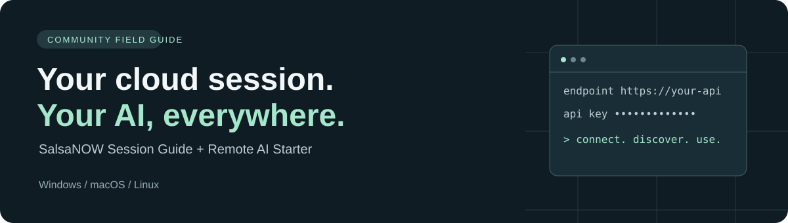

<p align="center"></p>

# SalsaNOW Session Guide & Remote AI Starter

[](https://github.com/Henner4746/salsanow-session-guide/actions/workflows/checks.yml)
[](https://www.python.org/downloads/)
[](LICENSE)

Practical community documentation for SalsaNOW / GeForce NOW sessions, with a remote AI starter for **Windows, macOS and Linux**.

**[Deutsch](README.de.md)** · [Session guide](docs/session-guide.md) · [Remote API guide](docs/remote-api.md) · [Test status](docs/verification.md)

Connect another computer to your own LM Studio endpoint: enter its address and API key, and the starter checks authentication, discovers model IDs and opens a configured terminal. It uses Python's standard library: no pip packages, administrator rights or background services.

This is an independent community guide, not SalsaNOW, NVIDIA or LM Studio software. It provides no public AI endpoint or credentials. Server setup and client setup are separate.

## Start in two minutes

1. Download this repository with **Code → Download ZIP**, or clone it, and extract it.
2. Install **Python 3.10+** from [python.org](https://www.python.org/downloads/) if needed. On Windows, the installer's PATH option is useful.
3. Run the starter for your operating system:

| System | Starter | Command from the extracted repository |
|---|---|---|
| Windows | Double-click `start-windows.cmd` | `.\start-windows.cmd` |
| Windows PowerShell | `start-windows.ps1` | `powershell -NoProfile -File .\start-windows.ps1` |
| macOS | `start-macos.command` | `sh ./start-macos.command` |
| Linux | `start-linux.sh` | `sh ./start-linux.sh` |
| Any supported system | Python directly | `python remote_ai.py` or `python3 remote_ai.py` |

If macOS refuses to open an unsigned downloaded launcher, use the Terminal command above. There is no need to disable system protections. If PowerShell blocks a script, use the `.cmd` starter.

Enter an endpoint such as `https://api.example.com/v1` and your **LM Studio API key**. A root URL such as `https://api.example.com` is accepted too. The key input is hidden. The program refuses public plain-HTTP URLs and will not forward keys across redirects.

The default opens a new terminal with these process-local variables:

| Variable | Purpose |
|---|---|
| `OPENAI_BASE_URL`, `OPENAI_API_KEY` | OpenAI-compatible clients |
| `ANTHROPIC_BASE_URL`, `ANTHROPIC_AUTH_TOKEN` | Anthropic-compatible clients, including Claude Code |
| `API_BASE_URL`, `API_KEY`, `API_MODEL` | Generic examples in this repository |
| `LM_API_TOKEN` | LM Studio clients that support it |

The first model whose ID does not identify it as an embedding model is selected by default. All discovered IDs are shown; use `--model MODEL_ID` to choose one. This name-based detection is a convenience, not a model-capability guarantee. The server may list downloaded models that still need loading.

**Close the child terminal to end this configured session.** The parent terminal, registry and shell profile are untouched. Keys remain accessible to software you launch in that terminal; only launch software you trust. Nothing here installs Claude Code or rewrites every app's settings: GUI clients may require their own endpoint and key fields.

## Check or chat without a configured terminal

```console
python remote_ai.py --check
python remote_ai.py --chat
python remote_ai.py --endpoint https://api.example.com/v1 --chat
python remote_ai.py --chat --model YOUR_MODEL_ID
```

These modes still prompt for the API key. `--check` checks authentication and model discovery; it does not generate a completion. `--chat` tests a real completion and then provides a small interactive chat. No conversations are saved. Reasoning models may need a larger output budget: `--max-tokens 2048`.

For noninteractive use, provide `API_BASE_URL` and `API_KEY` in the process environment and run `python remote_ai.py --check`. There is deliberately no `--api-key` option or secret configuration file.

## Host-side setup

Read [the session guide](docs/session-guide.md) before changing a cloud session. A remotely managed Cloudflare tunnel is configured in the dashboard and run as a normal process on the host. **Do not use `cloudflared service install` inside a session without administrator rights.** The tunnel connection token and the client's LM Studio API key are different credentials.

## Troubleshooting

| Symptom | Next step |
|---|---|
| Python not found | Install Python 3.10+; restart the terminal |
| Connection error / timeout | Check that the host session and connector are running |
| HTTP 401 with key | Confirm the LM Studio key and whether it survived session reset |
| HTTP 403 | Check Cloudflare Access/policies; a model key may not satisfy them |
| HTTP 404 | Check the base path and endpoint compatibility |
| HTTP 502 | Check the host's local server and port |
| HTTP 530 or Cloudflare error page | Read the Cloudflare error code; check DNS and tunnel health |
| Unauthenticated request succeeds | Enable authentication before using a public endpoint |
| No models / unknown model | Load a suitable model and use its reported ID |
| Empty completion | Increase output budget; inspect reasoning-model settings |

## Help improve this guide

| Looking for... | Start here |
|---|---|
| Persistent files, Git Bash and session recovery | [Session troubleshooting](docs/session-guide.md) |
| Claude Code, Python or a GUI client | [Remote API guide](docs/remote-api.md) |
| A quick visual walkthrough | [Example terminal session](docs/walkthrough.md) |
| Exactly what was verified | [Evidence and test status](docs/verification.md) |
| A reproducible problem report | [GitHub issues](https://github.com/Henner4746/salsanow-session-guide/issues) |

[Contributing](CONTRIBUTING.md) explains how to report reproducible fixes. Include versions and redacted results, never keys or raw settings files. [Security](SECURITY.md) explains credential handling. [Sources](docs/sources.md) distinguish official documentation from supplied session observations.

Local checks: `python -m unittest discover -s tests -v`. CI runs the same suite on Windows, macOS and Linux. Automated checks do not prove a real cloud session survives a restart.

Documentation and scripts are available under the [MIT license](LICENSE).
